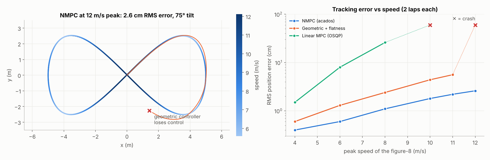
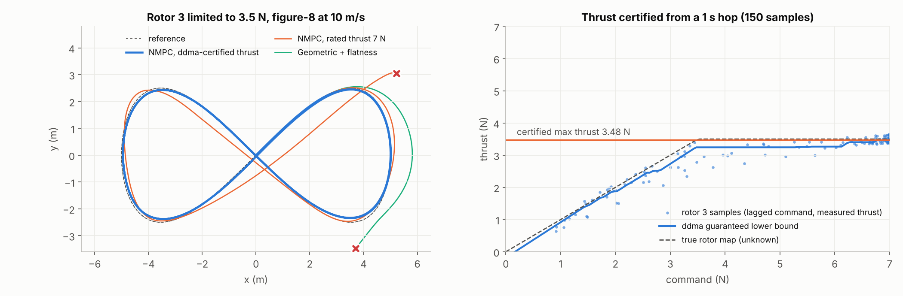
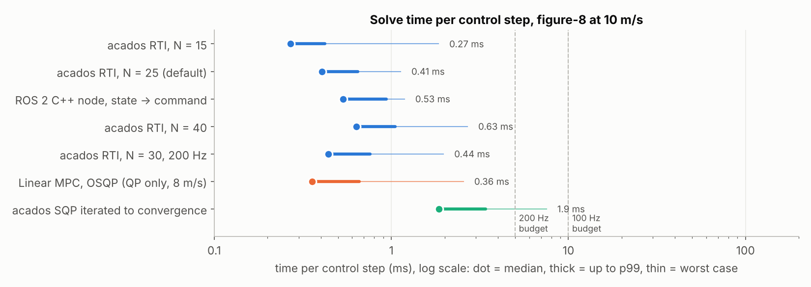

# quadrotor-nmpc: real-time nonlinear MPC for aggressive quadrotor flight

A nonlinear model predictive controller that flies a quadrotor through a figure-8 at up
to 12 m/s and 75° of tilt, commanding the four rotor thrusts directly. Each step takes
under half a millisecond, and the controller runs as a C++ ROS 2 node. It is compared
with the geometric controller used in most autopilots and with a linear MPC. When a
propeller is damaged, the controller plans with per-rotor thrust limits **certified from
one second of flight data** by [ddma](https://github.com/anas-makdesi/ddma), and keeps
flying where the others crash.

| | |
|---|---|
| **≈ 0.4 ms** | median solve time per control step (acados, real-time iteration, 25 shooting intervals, 100 Hz); worst case over two laps ≈ 1.1 ms. 200 Hz fits as well |
| **2.6 cm** | RMS tracking error at 12 m/s peak speed. The geometric controller crashes at that speed; the linear MPC crashes from 10 m/s |
| **2.4× lower error** | than the geometric controller at 10 m/s (1.8 vs 4.4 cm RMS) |
| **0 crashes** | with rotor 3 limited to half its thrust, using the limits ddma certified from a 1 s hop (3.48 N for a true 3.5 N). With the rated limits the NMPC crashes in the second lap, and the geometric controller in the first |



## What it does

| 1 · Model | 2 · Optimise in real time | 3 · Know the rotors | 4 · Deploy |
|---|---|---|---|
| 13-state rigid body (quaternion), rotor thrusts as inputs, rotor drag; flat full-state reference | acados multiple shooting, Gauss-Newton SQP, one real-time iteration per step, HPIPM, 1 s horizon | ddma turns in-flight thrust measurements into a guaranteed lower bound on what each rotor can give | Generated C code inside a ROS 2 C++ node; 1 kHz simulator node; launch test; Docker |

The controller tracks position, attitude, velocity, body rates and rotor thrusts from a
differential-flatness reference. It respects per-rotor thrust limits (hard, and
adjustable at run time) and body-rate limits (soft). Because it plans with the rotors
themselves rather than with a collective thrust and torques, it knows when a manoeuvre
would saturate a rotor. It then gives up a little position accuracy instead of attitude
control. A controller that allocates thrust after the fact cannot do this.

## Results

### Speed sweep: two laps of the figure-8

The figure-8 is 10 m wide. Peak speed is at the crossing point. The simulated
quadrotor adds first-order motor dynamics (30 ms), which the controllers do not model.

| Peak speed | NMPC (acados) | Geometric + flatness | Linear MPC (OSQP) |
|---|---|---|---|
| 4 m/s | **0.4 cm** | 0.6 cm | 1.5 cm |
| 6 m/s | **0.6 cm** | 1.3 cm | 8.0 cm |
| 8 m/s | **1.1 cm** | 2.4 cm | 26 cm |
| 10 m/s | **1.8 cm** | 4.4 cm | crash |
| 11 m/s | **2.2 cm** | 5.6 cm | crash |
| 12 m/s (75° tilt, rotors up to 6.8 of 7 N) | **2.6 cm** | crash | crash |

*Baselines:*
* **Geometric + flatness:** the SE(3) geometric controller (Lee, Leok, McClamroch
  2010) with acceleration, body-rate and torque feedforward, drag compensation and an
  attitude-priority mixer, as in common autopilots.
* **Linear MPC (OSQP):** linearised at hover with small-angle attitude error, on the same
  grid and reference.

### Damaged rotor: certified thrust

Rotor 3 gives at most 3.5 N of its rated 7 N; the controllers are not told. Before the
flight, the quadrotor does a 1 s vertical hop and records each rotor's command and its
measured thrust (from the IMU through the inverse mixer, noise ±0.15 N). Assumptions:
each rotor's thrust is a non-decreasing, concave function of its command (it can only
saturate), with bounded slope, and the motor lag is known. Under these assumptions,
ddma's `GrowthMap` gives a lower bound on every rotor's thrust curve that holds during
transients as well. Certified maxima: **6.56, 5.53, 3.48, 6.27 N** for a true 7, 7, 3.5,
7 N.

| Figure-8 at 10 m/s, rotor 3 limited to 3.5 N | RMS error | Result |
|---|---|---|
| NMPC with the rated thrust (7 N) | n/a | **crashes after 5.4 s** |
| **NMPC with the ddma-certified thrust** | **10 cm** | flies both laps |
| NMPC with the true limits (oracle) | 9 cm | flies both laps |
| Geometric + flatness | n/a | crashes after 1.8 s |

The certificate is conservative on the healthy rotors (it only certifies what the hop
showed). That costs 1 cm against an oracle that knows the true limits.



### Timing

All values were measured in closed loop over two laps at 10 m/s. They give acados'
internal solve time per step. Absolute values depend on the machine; re-run
`examples/benchmark.py` on the target hardware.

| Solver | Median | p99 | Worst | Tracking error |
|---|---|---|---|---|
| acados RTI, N = 15 | 0.27 ms | 0.42 ms | 1.8 ms | 1.4 cm |
| **acados RTI, N = 25 (default), 100 Hz** | **0.41 ms** | 0.65 ms | 1.1 ms | 1.8 cm |
| acados RTI, N = 40 | 0.63 ms | 1.1 ms | 2.7 ms | 2.0 cm |
| acados RTI, N = 30, **200 Hz** | 0.44 ms | 0.76 ms | 2.0 ms | 1.7 cm |
| ROS 2 C++ node: state → command | 0.53 ms | 0.86 ms | 2.4 ms | 1.7 cm |
| acados SQP to convergence (5 iterations median) | 1.9 ms | 3.4 ms | 7.5 ms | 1.8 cm |
| Linear MPC, OSQP (QP only; at 8 m/s, as it crashes at 10) | 0.36 ms | 0.66 ms | 2.6 ms | 25 cm |

* Iterating each step to convergence gives the same tracking as one real-time iteration
  at about 4× the cost.
* Finer grids are not better here; the 1 s horizon length matters more.
* All solvers fit the 100 Hz budget with a wide margin.



## Engineering

* **C++ / ROS 2 Jazzy** (`ros2/`):
  * `quadrotor_nmpc_msgs`: `QuadState`, `RotorThrusts`, `ControllerStats`.
  * `quadrotor_nmpc_ros`:
    * `nmpc_node` runs the generated solver and the flat reference in C++. Per-rotor
      thrust limits are a run-time parameter, e.g. fed by a fault monitor.
    * `sim_node` runs the rigid body, motor lag and rotor faults at 1 kHz in real time.
* **One source of numbers:** `scripts/export_c_code.py` writes the solver and a header
  with the vehicle constants, mixer and grid. **Parity tests:** the C++ plant (with
  motor lag and a capped rotor) matches Python to 10⁻⁹, and the flat reference to 10⁻⁹
  in state and 10⁻⁶ in thrust. The C++ solver wrapper reproduces the Python controller's
  commands over 150 closed-loop steps to 10⁻⁶. A launch test flies 15 s in real time and
  checks tracking error, solver status and latency.
* **ROS 2 flights in real time:**
  * healthy rotors: 1.7 cm RMS error, 0.53 ms median latency;
  * damaged rotor with certified limits: 14 cm RMS error;
  * damaged rotor with rated limits: the quadrotor is lost.

  Results are in `results/ros2_*.json`.
* **CI** (GitHub Actions): ruff, pytest (with acados built from a pinned commit), and
  `colcon build` plus `colcon test` in a `ros:jazzy` container. **Docker** image with
  everything built.

## Quick start

```bash
scripts/install_acados.sh ~/acados
export ACADOS_SOURCE_DIR=~/acados LD_LIBRARY_PATH=$LD_LIBRARY_PATH:~/acados/lib
pip install -e ".[dev]"
pip install -e ".[thrust]"   # ddma v0.12.0, for the thrust certificate

python examples/figure8_comparison.py   # experiments above -> results/figure8.json, figures
python examples/benchmark.py            # timing table -> results/timing.json
pytest -q
```

```python
from qnmpc.params import Quad
from qnmpc.trajectory import Figure8
from qnmpc.nmpc import NMPC, NMPCConfig
from qnmpc.sim import fly

quad, traj = Quad(), Figure8(v_peak=12.0)
flight = fly(NMPC(quad, traj, NMPCConfig()), quad, traj, duration=2 * traj.period)
print(flight.summary())
```

ROS 2 (Jazzy):

```bash
python scripts/export_c_code.py
mkdir -p ~/ws && ln -s $PWD/ros2 ~/ws/src && cd ~/ws
colcon build --cmake-args -DCMAKE_BUILD_TYPE=Release && source install/setup.bash
ros2 launch quadrotor_nmpc_ros figure8.launch.py v_peak:=10.0
ros2 launch quadrotor_nmpc_ros figure8.launch.py rotor3_max:=3.5 limits:="[6.56,5.53,3.48,6.27]"
python3 src/quadrotor_nmpc_ros/scripts/flight_probe.py --seconds 9   # summary of the flight
```

Docker: `docker build -f docker/Dockerfile -t quadrotor-nmpc . && docker run --rm -it quadrotor-nmpc`.

## Repository layout

```
src/qnmpc/      params, model (CasADi + plant), trajectory (flat figure-8), nmpc (acados),
                baselines (geometric, linear MPC), thrust (ddma certificate), sim, plotting
examples/       figure8_comparison.py, benchmark.py
scripts/        install_acados.sh, export_c_code.py, make_cpp_fixtures.py
ros2/           quadrotor_nmpc_msgs, quadrotor_nmpc_ros (nodes, launch, tests, flight probe)
results/        JSON outputs of the examples and of the ROS 2 flights
```

## Modelling notes and assumptions

* **What the simulation models.** The plant adds motor lag, linear rotor drag and rotor
  faults to the controller's model. The next robustness tests add richer aerodynamics, a
  battery model, sensor noise and a state estimator.
* The flight starts on the reference, at speed, so the comparison is about tracking,
  not take-off.
* **What the thrust certificate assumes.** The rotor maps described above and a bounded
  measurement error. In tests it never exceeds the true rotor thrust: capped rotors,
  lower efficiency, three fault cases.
* **Timings** vary by about ±30 % between runs on a shared machine. The tables give
  rounded values from one run.

## Next

Online thrust certification during flight (detect a fault mid-air and re-plan); a
gate-racing track with time-optimal references; Crazyflie-scale parameters and a
hardware-in-the-loop run with PX4.

---
Developed with help from Claude (Anthropic) for code, experiments and documentation.
